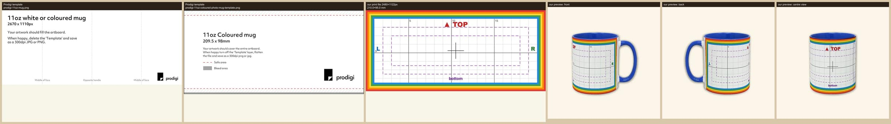
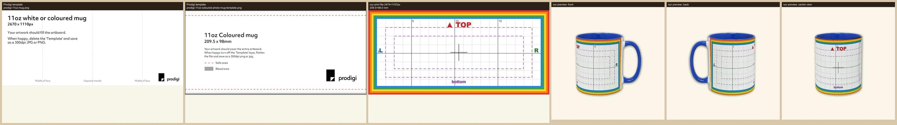
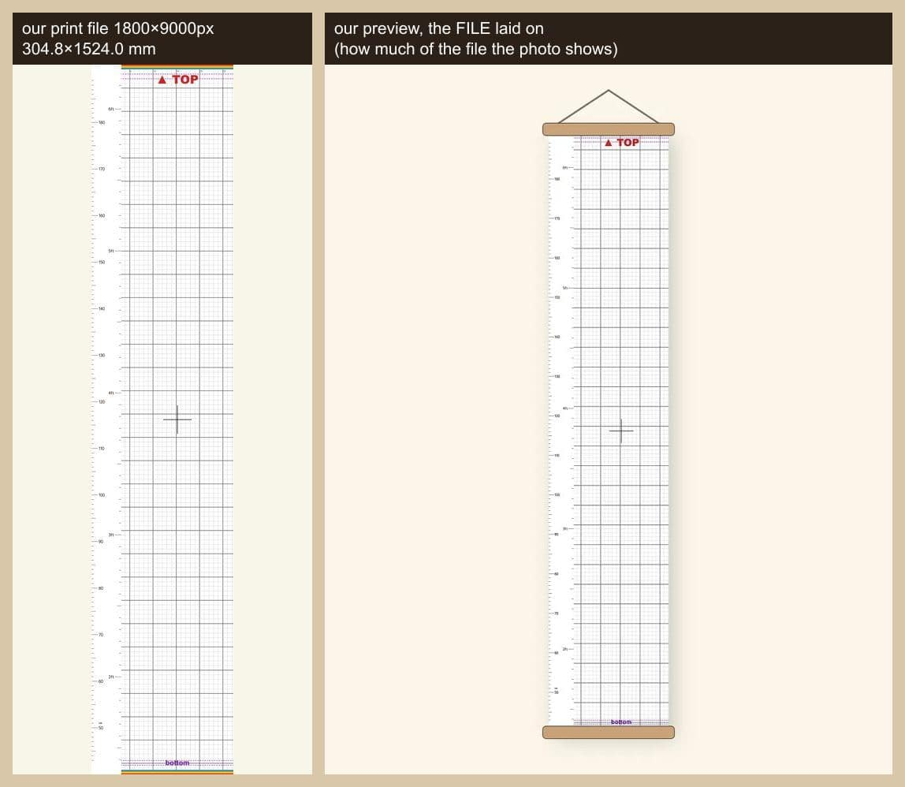
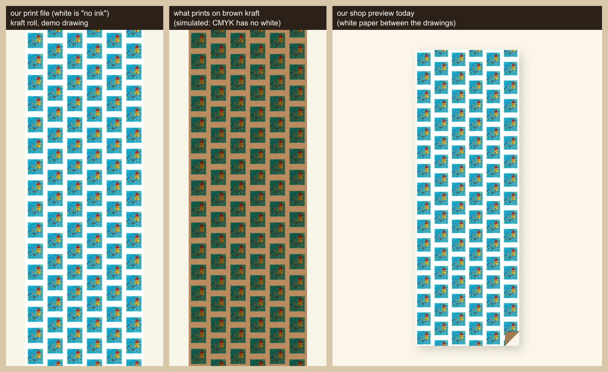
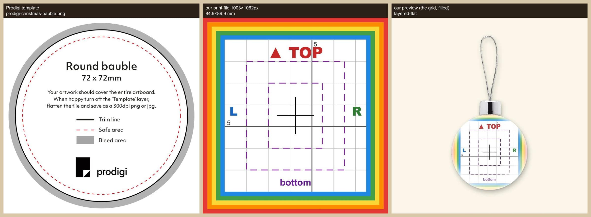
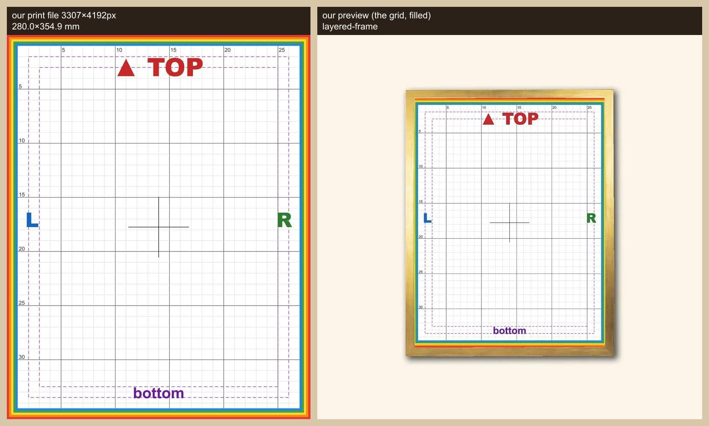
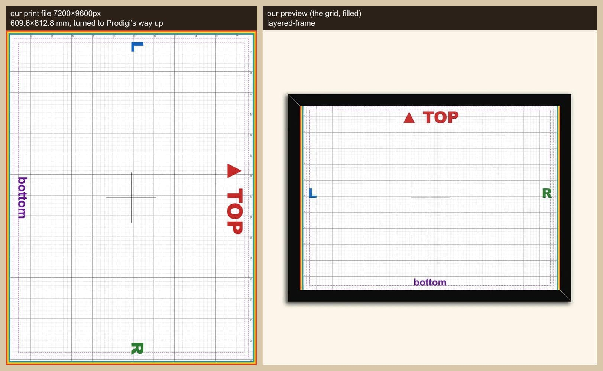
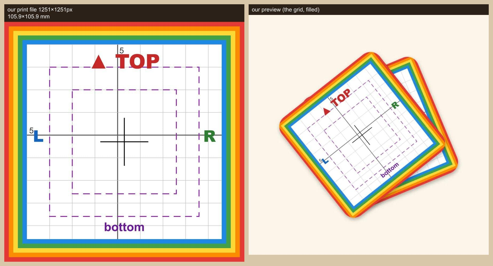

# Print audit: does every product print the way we show it?

28 Nov 2026 · for Simon · after the mug sample · no orders placed, no product code changed, nothing deployed

## The short answer

**No other product repeats the mug's mistake.** Three need settling before Christmas orders build up: the 150 cm height chart, the new blue mug and the plastic bauble. A few pictures need small code fixes, the kraft wrapping paper most of all.

The mug mistake was: we sold a Prodigi product line whose own name in their system says it prints less than the product looks. I checked Prodigi's own description of **all 228 product codes** we use (or are about to use). **Only the seven two-tone mugs** carry a warning like that ("[NOT top-to-bottom printing]"). No other code we sell has one.

But a product can still print differently from our picture without any warning word. So I also measured, **to the millimetre**, how much of every print file each shop picture shows. That covered 263 picture shapes: every size, colour, orientation and phone model (hidden products included). I then compared that with what Prodigi actually prints.

Worst first:

| # | Product | Rating | In one line | What settles it |
|---|---|---|---|---|
| 1 | **Mug (two-tone, sold until today)** | ❌ was wrong, now fixed | Prodigi's own product name says "NOT top-to-bottom"; our picture showed it printed rim to base. | **Fixed:** PR #111 (merged into the Christmas branch on 28 Nov) switched to the top-to-bottom range. It reaches customers on the next deploy. |
| 1b | **Mug (the new coloured mugs, PR #111)** | ⚠️ risk | Right range, right size, and no warning. But **blue (our default) and orange aren't listed on Prodigi's public page**, which is the same gap that caught us last time. | Ask Prodigi, **and** order one blue sample before pushing mugs. |
| 2 | **Height chart, 150 cm sizes** | ⚠️ risk, high | Prodigi's page and their system both say the canvas is **150 cm** long. Our file and ruler are drawn for **152.4 cm**. If Prodigi fits our file to 150 cm, the marks near the top read up to **2.4 cm** too high. | Ask Prodigi, then measure a sample with a tape. The 120 cm charts are fine. |
| 3 | **Kraft wrapping paper** | ⚠️ risk | Our picture shows **white paper** between the drawings. Kraft prints no white, so the real roll is **brown there**, and the colours come out darker. Our description says so in words, but the picture doesn't. | Code fix: show the kraft colour through the white in the picture. |
| 4 | **Plastic bauble** | ⚠️ risk | Still open from 16 Nov: the shape and size of the printed card inside the ball are not confirmed. | Ask Prodigi, or one cheap sample. |
| 5 | **Framed prints** | ⚠️ small risk | The frame hides 5 mm of every edge (Prodigi: "rebate width 5mm"). Our pictures show 0 mm hidden on two edges and up to 17 mm hidden on the other two. A name written right at the edge could disappear under the frame. | Code fix: hide exactly 5 mm all round in the picture. |
| 6 | **Coasters and placemats** | ⚠️ small risk | The picture shows the 3 mm (coaster) or 2.5 mm (placemat) edge that gets cut off. On a 10 cm coaster that's 6% of the width. | Code fix: show the finished size, as we already do for playing cards. |
| 7 | **Phone cases: Christmas date** | ⚠️ small risk | We say order by 16 Dec. Prodigi's recommended date for phone cases on Standard post is **15 Dec**, and most cases now go Standard. | Code fix: change one date. |
| 7b | **Calendar: the 3D "spin" view** | ⚠️ risk | The spin view paints the drawing **edge to edge** on the page, where the shopper placed it. The printed page always fits the **whole drawing inside a 1 cm white border**, wherever it was placed. (The flat picture is right; only the spin view is wrong.) | Code fix F9. |
| 8 | **Calendar: "tracked"** | ⚠️ small risk | We say "free tracked delivery". Prodigi's carrier for the calendar lab is just called "Mixed", so tracking is not confirmed. | Ask Prodigi, or drop "tracked" for the calendar. |
| — | Everything else | ✅ OK | Cushions, blankets, tees, jigsaws, cards, calendar print, ceramic ornament, multi photo frames, phone case print, watch strap, socks, tea towel, white wrapping paper, playing cards, 120 cm height charts. | Nothing needed. |

**Every product we sell is made in the UK.** I quoted every code to a UK address: none goes to a lab abroad. The only non-UK route I found is the **black** coloured mug (Sweden), and PR #111 leaves it out.

## Your turn

1. **Deploy the Christmas branch** so the new mug (PR #111, merged) goes live. Then, before you advertise mugs, **order one blue mug sample**. Blue is our default and isn't on Prodigi's public page (see #1b).
2. **Send Prodigi the questions** at the end. They cost nothing and cover #1b, #2, #4 and #8. If you sent the 16 Nov questions and got answers, tell me and I'll fold them in.
3. **Samples worth ordering** (all three ship in a few days): the blue mug, a 150 cm height chart (measure the "100" and "180" marks with a tape) and a plastic bauble.
   - Optional: a 2 m kraft roll, if you want to see the colours for yourself.
4. **Say yes or no to the code fixes** listed at the end (#3, #5, #6, #7, #7b). I haven't made any; each would be its own small PR.
5. Until #2 is settled, you could **hide the two 150 cm height chart sizes**. The 120 cm sizes are safe to keep selling.

## How the mug slipped through, and what now stops it

- Prodigi's system lists a **print size** for every product. For the two-tone mug it is 2480×1122 px, a normal full-wrap shape. Our existing guard test checks that our file is exactly that size, so it passed.
- The warning was in the **words**: "11oz Two Toned Ceramic Mug, White Blue **[NOT top-to-bottom printing]**". Nothing read them.
- The two-tone mugs **have no public page** at all on prodigi.com. The only page showing a white mug with a coloured inside and handle is the *coloured* mug page, which says "top to bottom". So the page and the product code described different mugs.
- The 16 Nov audit did spot the warning. It was then closed using photos of Prodigi's mugs. Those were most likely the coloured range, not the two-tone one, and I should have caught that.

**New guard test** (in this PR, `src/server/__tests__/prodigi-print-warnings.test.ts`):
- reads Prodigi's own description of every product code in the shop, from a saved copy, so the test never calls Prodigi;
- **fails if any product on sale is described with words like** "NOT top-to-bottom", "partial", "not full wrap", "not edge-to-edge", "smaller print area", "front only" or "one side only";
- also fails if we sell a double-sided cushion on a product code Prodigi calls single-sided, or the other way round, or if our own words promise "both sides" on something single-sided;
- there's a short "known" list for a product that has to stay on sale with a warning for a while. It's empty now that PR #111 has taken the two-tone mugs off sale. Anything on it must still be on sale, or the test fails until it's removed.
- I checked it really catches the mug: with the known list emptied, it fails and names all seven two-tone codes.

The existing print-size guard (`print-spec.test.ts`) still checks every file is exactly Prodigi's size. I re-ran it against **today's** Prodigi data (not only the saved copy) and every product on sale matches, tube socks included.

To refresh the saved copy after adding a product, run `scripts/fetch-prodigi-product-notes.ts`, next to the existing `scripts/fetch-prodigi-print-areas.ts`.

## How I checked

1. **Prodigi's system, every code.** I asked Prodigi's system about all 221 codes in the catalogue, plus the 7 coloured mugs from PR #111: the description, product size and print sizes. Read-only, sandbox.
2. **Where each one ships from.** 469 "how would you send this?" quotes to a UK address on Standard post, plus 166 on Express, for phone cases and the products with no Express. These are quotes only: nothing ordered, and no prices written down.
3. **Prodigi's public pages and downloadable templates** for every range: the cushion and blanket templates (opened from their Photoshop files), the calendar PDF, and the mug, ornament, bauble, card, sock, tea towel and phone case templates.
4. **A measuring grid through the shop's own picture code**, for 32 products and variants. The grid has coloured bands 2 mm wide in from each edge (red, orange, yellow, green, blue), a 1 cm grid, dashed lines at 20 and 30 mm, and "TOP", "L", "R" marks. The side-by-side pictures below come from this.
5. **A millimetre measurement of every shop picture.** Each picture is made four times through the shop's code: once white, once black, and twice with a colour code where the colour of every dot says which spot of the print file it came from. That gives, for every edge, exactly how many mm of the file the picture leaves out.
   - It ran on all 263 picture shapes, hidden products included: every frame colour and size, every phone model, every tee size.
   - The numbers can only *over*-state how much is hidden, because shadow on a photo edge can hide a little more. So "the picture shows the file right to the edge" is always a safe reading.
6. **Re-checked every point in the 16 Nov report** (table near the end).

Caveat: Prodigi's system data comes from the **sandbox**. On 23 Nov the tube socks' print size differed between sandbox and live, and live wins. Today's sandbox matches live for the socks. The weekly check on the server reads live; see fix F7.

## Product by product

"Hidden" means the millimetres of our print file that our shop picture does *not* show, per edge: left / right / top / bottom of the design as the customer sees it. Each image shows, left to right: Prodigi's template (where there is one) · our print file with the grid · our shop picture with the same grid.

### ❌ 1. Mug: two-tone (sold until PR #111) · `mug-twotone-blue.jpg`



- **Prodigi's system:** "11oz Two Toned Ceramic Mug, White Blue [NOT top-to-bottom printing]". All 7 colours say the same.
- **Print size:** 2480×1122 px (210×95 mm). Our file matches exactly, which is why the size check passed.
- **Public page:** none for these codes.
- **Our picture:** the front, back and centre views together show the whole file. Hidden top and bottom: 0–0.3 mm, so the picture prints right to the rim and base.
- **The real mug** (your sample): white bands top and bottom and a bare gap at the handle.
- **Ships:** uk9, Royal Mail Tracked 48. Matches `season.ts` and `parcels.ts`.
- **Settled:** PR #111, merged on 28 Nov. Goes live with the next deploy.

### ⚠️ 1b. Mug: the new coloured mugs (PR #111, merged) · `mug-coloured-blue.jpg`



- **Prodigi's system:** "11oz White Ceramic Mug with blue handle, blue inner mug", with no warning on any of the 6 colours.
- **Print size:** 2474×1157 px = 209.5×98 mm. That is **exactly** Prodigi's downloadable "11oz Coloured mug" template (209.5 × 98 mm), so it matches.
- **Public page** ([coloured photo mugs](https://www.prodigi.com/products/home-and-living/drinkware/coloured-photo-mugs/)):
  - It says "top to bottom, full colour, photographic print" and "allow 1–2mm of artwork movement".
  - It lists the red, yellow, pink and light green codes.
  - It **doesn't list H-MUG-11OZ-BLU or -ORG**, although "orange" and "sky blue" appear in its colour list.
- **The template:** a grey "bleed" band of 1 mm at the top and 2 mm at the bottom, and a dashed "safe area" about 4 mm in. The merged code takes that bleed off every mug picture. Measured on all 6 colours, the pictures hide 0–1.6 mm at the top and 2.1–2.3 mm at the bottom, so they match.
- **Which way round:** our picture puts the two ends of the file at the handle and the middle on the far side. Prodigi's white-mug template agrees ("middle of face", "opposite handle").
- **Ships:** uk5, Royal Mail RM24, which is untracked and has no Express. PR #111 changed the delivery wording to match.
- **Settle:** ask Prodigi to confirm that **BLU and ORG** are the same top-to-bottom range, and **order one blue sample** before advertising.

### ⚠️ 2. Height chart · `height-chart-30x150.jpg`



- **Prodigi's system:** "Wall height chart print on polycanvas with poster hanger, 8x60" / 20.3x152.4cm". But its product size says **150 cm**, and so does the public page (203 × **1500** mm, 305 × **1500** mm).
- For the 48″ charts, all three sources agree on 121.9 cm.
- **Print size:** 1200×9000 / 1800×9000 px. At Prodigi's 150 dpi that is 152.4 cm, and **our ruler is drawn for 152.4 cm**.
- **If the canvas is really 150 cm** and Prodigi fits our file to it, the ruler shrinks by 1.6%. Hung correctly, the "100" mark would sit at 99.1 cm and the "190" mark at 187.6 cm, about **2.4 cm** out.
- On a height chart, accuracy is the product, so this matters.
- **Hangers:** Prodigi says the "wooden strips cover up to 1.5cm of the print at the top and bottom". Our ruler keeps its marks 2.5 cm from the ends, which is good. But our picture draws the hangers *outside* the canvas and shows the whole file (hidden 0.7–2.8 mm at the top, 5–6 mm at the bottom). So a drawing's top or bottom 1.5 cm can disappear under the wood. See fix F5.
- **Ships:** gb3, Evri Next Day 24 (tracked). Matches.
- **Settle:** Prodigi question 2, plus measuring a sample with a tape.

### ⚠️ 3. Wrapping paper: kraft · `wrapping-paper-kraft-colour.jpg`



- **Prodigi's system:** "1 x roll Kraft, recyclable gift wrapping paper", with no warning.
- **Print size:** exact (8280×23610 px for the 2 m roll, and so on).
- **The problem is colour, not size.** Kraft is printed with no white ink, so wherever our file is white (the gaps, and the white paper the child drew on) the brown paper shows. The colours come out darker too.
- Our shop picture shows **bright white paper** between the drawings (right-hand panel). The middle panel is a simulation of what brown kraft does to the same file.
- Our product description already says "the paper shows through where the drawing is white", but the picture contradicts it.
- **Geometry is fine:** the kraft picture shows the whole roll, hidden 0–5.5 mm at the edges.
- **Ships:** gb2, Evri Standard 48. Prodigi's sandbox now quotes Evri, which is tracked, but the shop says untracked ("free delivery"). That is under-promising, which is harmless. Check live before changing the wording.
- **Settle:** code fix F1.

### ⚠️ 4. Plastic bauble · `plastic-bauble.jpg`



- **Prodigi's system:** "Personalised Christmas Bauble Ornament 8x8cm / 3x3"", with no warning. Print size 1003×1062 px = 85×90 mm. Our file matches exactly.
- **Public page:** "printed onto a satin card insert", "showcased on both sides", product 79 × 84 mm.
  - 79 × 84 mm plus 3 mm bleed all round is exactly 85 × 90 mm, so the file is probably the insert plus bleed.
  - But a flat 79 × 84 mm card can only fit an 8 cm ball if it's a rounded shape, and the page doesn't say which.
- **The downloadable template** in our folder is a 72 mm circle. It is identical, word for word, to the *ceramic* ornament's template, so it may not be the plastic bauble's at all.
- **Our picture** hides 2.4 / 2.8 / 5.6 / 12.9 mm (left / right / top / bottom).
  - If the insert is the 79 × 84 mm shape, the picture shows a little *less* than prints at the top and bottom.
  - If it's a 72 mm circle, the picture shows about 4 mm *more* than prints on each side.
- **Ships:** uk5, Royal Mail RM24, untracked, and the shop says so. No Express.
- Prodigi's Christmas dates page doesn't list baubles at all.
- **Settle:** Prodigi question 3, or one sample.

### ⚠️ 5. Framed prints · `frame-11x14-gold-portrait.jpg`, `frame-24x32-black-landscape.jpg`




- **Prodigi's system:** "Classic Frame, EMA 200gsm Fine Art Print, No Mount / No Mat, Perspex Glaze, 28x35cm/11x14"", with no warning. All 4 sizes have exact print sizes.
- **Public page** ([classic frames](https://www.prodigi.com/products/wall-art/framed-prints/classic-frames/)):
  - "Rebate width 5mm", so the frame lip covers 5 mm of the print on every edge;
  - "the size listed … refers to the size of the glaze".
- **Our pictures, measured across all 64 frames:**
  - **Portrait:** top and bottom hidden **0–1 mm** (the real frame hides 5). Left and right hidden **0–16 mm**, depending on colour; black and natural are the most cropped.
  - **Landscape:** left and right hidden **0 mm**. Top and bottom hidden **0.2–17 mm**.
- **So:**
  - on two edges the picture shows up to 5 mm that the frame will cover;
  - on the other two, some frame colours hide up to 12 mm *more* than the real frame does, which the customer never saw.
- The 16 Nov report said "our preview hides about the same". That was wrong for most colours and sizes.
- **Ships:** gb3. Evri Next Day 24 for 11×14 and 12×16, DPD Local Next Day for 18×24 and 24×32. Both tracked. Matches.
- **Settle:** code fix F2.

### ⚠️ 6. Coasters and placemats · `coaster.jpg`, `placemat.jpg`



- **Prodigi's system:** "Cork drink coaster, 4" / 10cm" and "Wooden cork placemat, 11 x 8" / 28.5 x 20cm", with no warning. Print sizes exact.
- **Our files:**
  - coaster 1251 px = 106 mm for a **100 mm** coaster, so about 3 mm is cut off each edge;
  - placemat 290 × 205 mm for a **285 × 200 mm** mat, so about 2.5 mm each edge.
- **Our pictures show the cut-off edge** (hidden 0.2–0.6 mm on the coaster, 0–1.9 mm on the placemat). You can see the grid's red outer band on the coaster picture.
- **Ships:** uk9, Royal Mail Tracked 48. Matches; parcel group uk9-home.
- **Settle:** code fix F3.

### ⚠️ 7. Phone cases: the Christmas date

- **Print: OK** (see "OK" below).
- **Delivery:**
  - 94 of the 152 phone-case codes go Royal Mail **Standard Tracked** from uk6. Under the order-splitting rule from 26 Nov, those orders go **Standard**.
  - The other 58 go untracked RM24 from uk8 on Standard. Those are split into their own Express order, which goes uk6 and tracked. All 152 quote uk6 on Express.
- `season.ts` gives phone cases (route uk6) a last order date of **16 Dec**. That is Prodigi's **Express** date. Their Standard date is **15 Dec**.
- **Settle:** code fix F4.

### ⚠️ 8. Calendar: "free tracked delivery"

- **Print: OK** (see below).
- **Delivery:** uk15, carrier "Mixed · Mixed", with no Express.
- The shop calls it tracked, because `calendar` isn't in `UNTRACKED_STANDARD_KEYS`. But nothing in Prodigi's quote confirms tracking, and our own `isTrackedService` check reads "Mixed" as untracked.
- **Settle:** Prodigi question 4. Or put `calendar` on the untracked list (one line).

### The 3D views (the spin view, the wall view, the AR frame)

All three paint the drawing through one shared function, `paintPlacement` (`src/ui/three/models.ts:29`). Before PR #111 it assumed **every product has a 3 mm bleed**. PR #111 added a `bleedMm` argument and fixed the mug; every other caller still gets 3 mm. I checked the rest from the code; a 3D view needs a real browser, so these points weren't rendered:

| View | Products that use it | Real bleed | What it means |
|---|---|---|---|
| **Spin view** (`Product3D`) | Only the **mug**, **calendar** and storybook can spin (`src/ui/three/spinnable.ts`). The storybook is paused. Framed prints, cushions and blankets have **no 3D view** (founder's call, July). | mug 0 (fixed by PR #111) · calendar 0 | **Calendar:** it also ignores the calendar's gallery layout. The spin view paints the drawing **edge to edge** with the shopper's placement (`src/ui/three/builders.ts:138`). The print fits the whole drawing inside a **1 cm white border** and ignores placement (`galleryRect`, `src/server/print/geometry.ts:264`). The 3 mm assumption only adds a ~2% zoom on top. See F9. |
| **Wall view** (`WallView`) | Framed prints | 0 | **Not shown anywhere today.** Nothing in the app imports `WallView`. If it comes back, the 3 mm assumption would crop ~3 mm off each edge (about 2% zoom), on top of the 5 mm the frame hides (F2). |
| **AR frame** (`frameGlb`) | Framed prints | 0 | Only loaded from `WallView`, so **not reachable today**. Same note. |
| Cushions, blankets | (no 3D view) | 6 mm, 10 mm | Nothing to fix. If a 3D view is ever added, pass the real bleed: with a 3 mm guess it would show 3 mm (cushion) or 7 mm (blanket) of the sewn-in edge. |

### ✅ Fine as they are

| Product | Prodigi's words · size · lab | What our picture shows | Image |
|---|---|---|---|
| **Cushions** (heart, round, 12″ and 22″ squares, single and double) | "Single Sided" / "Double Sided" matches our variants. Sizes exact. uk3 FedEx Economy Tracked & Signed. | Hidden 5–16 mm. That is at least the 6 mm seam we already take off, plus the puffy edge. Prodigi allows a "0.25–0.5 inch tolerance". | `cushion-*.jpg` |
| **Fleece blankets** | Exact sizes. uk3 FedEx. (Prodigi's page and system list the large white blanket as 146 cm square; their own name says 100 × 150 cm, which is what we send. That is a typo on their side.) | Hidden 10–46 mm, more than the 10 mm stitched edge. The picture shows *less* than prints, which is the safe way round. | `blanket-*.jpg` |
| **Kids and adult tees** | Exact sizes, the same at every garment size. uk9 Tracked 48 for every size and colour. | Whole print area (hidden ≤1.4 mm). Prodigi still doesn't publish how far below the collar it goes, so expect ±1–2 cm of hand placement. | `kids-tee.jpg`, `adult-tee.jpg` |
| **Jigsaws** | "in metal tin with image on front". Page: "full edge-to-edge printing". Exact sizes. gb3 Evri Standard 48. | Hidden ≤1.8 mm. The tin lid (869×674 px, a slightly different shape) has its own picture made at the lid's shape. | `jigsaw-*.jpg` |
| **Greetings cards and packs** | Exact 4-panel spread. uk7 Guernsey Post, untracked, and the shop says so. | Whole front panel. The 1–2.5 mm bleed shows, too small to matter. | `card.jpg` |
| **Calendar** (print) | "A4 Calendar … includes 2027 calendar dates". Exact sizes. Template: "keep essential elements at least 10mm away from the edges". | Our layout keeps a 10 mm white margin. The picture hides 6–8.5 mm of that margin at the sides. | `calendar-a4.jpg` |
| **Ceramic ornament** | Page: "Single-sided print", "slight variations in alignment may occur". Exact size. uk9 Tracked 48. | Hidden about 1 mm all round. The real circle is cut 1.5 mm in, so near enough. | `ceramic-ornament.jpg` |
| **Multi photo frames** | Page: "60x60mm images with a clean 20mm border". Exact sizes. gb3 (24×36″ goes FedEx First). | Each window shows its square to within 0.2–1.6 mm. | `multi-frame-3x3.jpg` |
| **Phone cases** (all 76 models × snap / tough) | Exact sizes. Snap "printed edge to edge"; tough "fully 3D wrapped around the entire body". | The picture is the case back traced from Prodigi's own template for each model. The tough case's sides get the file's outer edge, which the back view doesn't show. That is the edge Prodigi's template calls "bleed … will run off the sides". | `phone-*.jpg` |
| **Watch strap** | Exact sizes. uk6 Standard Tracked. | Built from Prodigi's template; hidden ≤2.8 mm. | `watch-strap-large.jpg` |
| **Socks** (ankle, tube) | "One size fits all". Exact sizes (tube upright, 3543×6141, as live). uk9 Tracked 48. | Built on Prodigi's own templates (16 Nov). The picture hides the heel, toe and edges, and every drawing stays inside the safe lane. | `socks-*.jpg` |
| **Tea towel** | "Personalised Tea Towel". Exact size. Page: "hemmed edges", "white ink cannot be printed" (on a white towel, that's fine). | A repeat pattern; hidden up to 19 mm along the hemmed long edges. | `tea-towel.jpg` |
| **White wrapping paper** | Exact sizes. gb2 Evri. | A window onto the roll; a repeat pattern, so nothing that matters is cut. | `wrapping-paper-3m.jpg` |
| **Playing cards** | Page: "one image per deck", 64 × 89 mm. Exact size. uk5 RM24, untracked, and the shop says so. | Hidden 2.6–3.4 mm, the 3 mm trim we take off since 16 Nov. | `playing-cards.jpg` |
| **Height chart, 120 cm** | 121.9 cm everywhere. | As item 2, apart from the length question. | — |

**Not on sale, so not rated:**
- adult hoodie: its print size differs by route (known, hidden);
- baby bodysuit: its 18–24 month size has two routes, and it goes untracked Royal Mail 1st Class;
- Christmas jumper: some colours go untracked uk2;
- kids jumper, pet bandana, apron, storybook;
- Christmas sack: paused 16 Nov.

## The 16 Nov report, re-checked

| 16 Nov said | Today |
|---|---|
| Sack: the print box is smaller than the file | Still true. The sack is off sale. |
| Plastic bauble: insert size unknown | **Still open** (item 4). |
| Tube socks: wrong size | Fixed. The file is upright 3543×6141, matching live and today's sandbox. |
| Mug: settled by your photos, "prints rim to base" | **Wrong**: the photos were most likely the coloured range. Fixed by PR #111. |
| Cushions: 31 mm safe area not shown | Fixed: the seam is trimmed and the "cosy edge" guide is in. Measured above. |
| Tees: hand placement | Still unpublished by Prodigi. Expect ±1–2 cm. |
| Playing cards: 3 mm trim | Fixed; measured 2.6–3.4 mm hidden. |
| Ceramic ornament: OK | Still OK. |
| Height chart: hanging wording | Fixed. **New**: the 150 cm length question (item 2). |
| Watch strap: OK | Still OK. |
| Framed prints: "preview hides about the same 5 mm" | **Not true**: 0 mm on two edges, up to 17 mm on the others (item 5). |
| Multi frame, calendar, cards, jigsaw, blanket, tea towel: OK | Still OK. |
| Placemats and coasters: "Flat. Matches." | **Not quite**: the pictures show the cut-off edge (item 6). |
| Phone cases: OK | Print OK. The date is one day late (item 7). |

## Code fixes I'd propose (none made; each its own small PR, your yes first)

- **F1. Kraft picture** (item 3): on kraft, multiply the printed pattern over the kraft colour, so white shows as brown, in the shop pictures and the positioner. A test would check that a white pixel on kraft comes out kraft-coloured.
- **F2. Frame pictures** (item 5): set each frame photo's window so that exactly 5 mm of the file sits under the moulding on every edge, for every colour and size. The new measuring script (`scripts/print-audit/coverage.ts`) can then be a test: hidden 5 ± 1 mm on every edge.
- **F3. Coasters and placemats** (item 6): show the finished size (3 mm and 2.5 mm trim), the same way playing cards already work (`trimmedPx`). The file sent to Prodigi doesn't change.
- **F4. Phone-case date** (item 7): `season.ts` uk6 from 16 Dec to **15 Dec** (Prodigi's Standard date), because most cases now go Standard.
  - Also worth doing: every other date in `CHRISTMAS_LAST_ORDER` is on or before Prodigi's newly published dates, so we're safe; the table can drop "provisional".
- **F5. Height chart picture** (item 2): draw the wooden bars *over* the top and bottom 1.5 cm of the canvas, and keep drawings out of that strip.
  - If Prodigi says the canvas is 150 cm: draw the 60″ rulers at 150 cm, or keep 152.4 cm if they confirm it.
- **F6. "Tracked" wording:**
  - calendar: untracked until Prodigi confirms (item 8);
  - wrapping paper: could say tracked once live quotes show Evri;
  - our `isTrackedService` check doesn't recognise "FedEx First" (the 24×36″ multi frame) as tracked, although it is. Harmless today; worth a one-word fix.
- **F7. The weekly Prodigi check** (on the server, reading **live**): also read each product's description and email the support inbox if a warning word appears, the same words as the new guard test. That catches a live change between our sandbox snapshots.
- **F9. 3D views** (item 7b):
  - make `paintPlacement` take each variant's **real bleed** from its print template, instead of the 3 mm default (PR #111 added the argument for the mug);
  - on the **calendar**, paint the gallery page (the whole drawing inside the 1 cm white border) rather than the shopper's placement;
  - a small test could check that the spin view's painted area matches the print file's.
- **F8.** `NO_EXPRESS_KEYS` lists only the calendar, but the plastic bauble, playing cards and the PR #111 mugs have no Express either. Today's order split keeps them on Standard anyway, so nothing breaks, but the list should be complete.

## Questions to email Prodigi (free)

> Hello — a few print-spec questions before Christmas, please:
> 1. **11oz coloured mugs:** your coloured-mug page lists H-MUG-11OZ-RED, -YLW, -PNK and -LIGR as top-to-bottom. Are **H-MUG-11OZ-BLU** and **H-MUG-11OZ-ORG** the same range, printed top to bottom across the full 209.5 × 98 mm template?
> 2. **Height charts, 60″** (POSTER-HANGER-20-CAN-ROL-SC-8X60 and -30-…-12X60): the API print area is 9000 px tall (152.4 cm at 150 dpi), but your product page and productDimensions say 150 cm. How long is the printed canvas, and if it's 150 cm, is our 9000 px file scaled down to fit or cropped? We print a measuring ruler, so we need it to the millimetre.
> 3. **Plastic bauble (XMAS-PLAS-BAUB):** what shape and size is the satin card insert (the page says 79 × 84 mm), which part of our 1003 × 1062 px file lands on it, and is the same image on both faces? Is the 72 mm circle template right for this product?
> 4. **Calendars (CALENDAR-A4/A5-L-DATED):** the quote shows carrier "Mixed". Is UK delivery tracked?
> 5. (from 16 Nov, if not yet answered) **T-shirts (TEE-SS-STTK909, TEE-SS-STTM559):** how far below the collar is the top of the front print placed?

## Evidence files

Every `.jpg` here is a side-by-side made by `scripts/print-audit/render.ts`. Left to right: Prodigi's template (where there is one) · our print file with the measuring grid · our shop picture made by the shop's own code from that grid.

The grid's coloured bands are 2 mm each from the file's edge: red, orange, yellow, green, blue. The purple dashed lines are 20 and 30 mm in. If you can see red in a picture, it shows the outermost 2 mm of the file.

The millimetre numbers come from `scripts/print-audit/coverage.ts`. Re-run both on your PC, where `.prodigi-assets` lives:

```bash
npx tsx --conditions=react-server scripts/print-audit/coverage.ts coverage.json
```

```bash
npx tsx --conditions=react-server scripts/print-audit/render.ts out
```

No Prodigi prices are written anywhere in this folder, the scripts or the fixtures.
